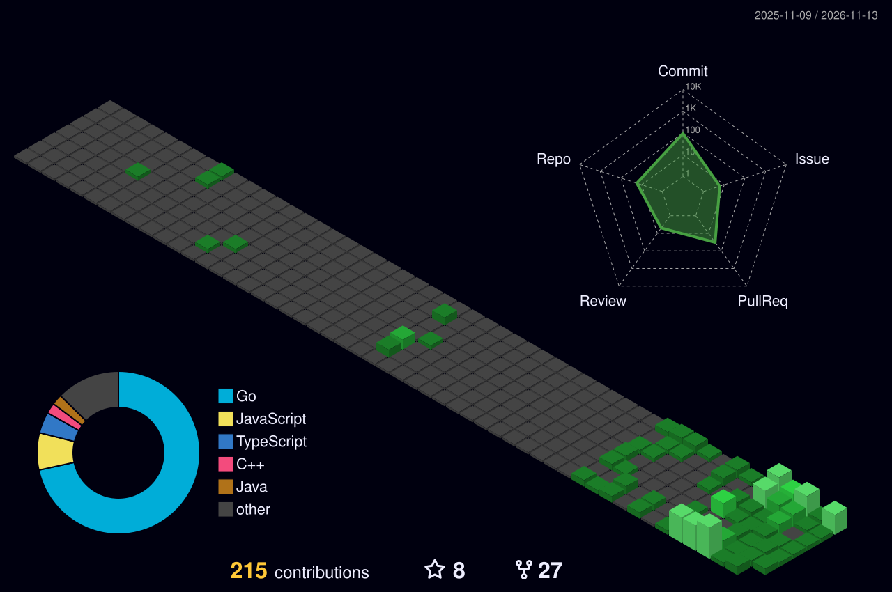

<h1 align="center">Shashank Reddy</h1>

Reliability and security of cloud-native infrastructure 
Go &nbsp;·&nbsp; C++ &nbsp;·&nbsp; Java &nbsp;·&nbsp; Kubernetes &nbsp;·&nbsp; Observability &nbsp;·&nbsp; Contributor to CNCF projects

<i>I like the unglamorous edges of infrastructure: the auth check that trusts too much, the default that's quietly too slow, the bug that only shows up under load.</i>

  
  
  
  
  
  
  
  
  

---

## Open Source Work

<b>25 merged PRs across 5 CNCF projects</b>

<table>
  <tr>
    <td></td>
    <td>Bearer-realm SSRF denylist, copy concurrency 3→8, push digest verification, credential-log redaction, &gt;8 GiB PAX tar reads, containers/image-compatible <code>auth.json</code> lookup, and OCI reference-name validation</td>
  </tr>
  <tr>
    <td></td>
    <td>Sliding-window rate limiting and IP access control lists for the proxy</td>
  </tr>
  <tr>
    <td></td>
    <td>Service resource detector, schema-correct config defaults, pkg-config packaging</td>
  </tr>
  <tr>
    <td></td>
    <td>GPU power-attribution tests without physical hardware, Helm extra volumes, mounts and environment variables for Redfish, power-monitor error-path tests, and native Go parser fuzzing</td>
  </tr>
  <tr>
    <td></td>
    <td>OID4VCI client-scope fix (Admin UI and backend), mdoc E2E coverage</td>
  </tr>
</table>

<a href="./OPEN_SOURCE.md"><b>Full list of merged PRs →</b></a>

---

## Building

  <a href="https://github.com/shashankxrm/deskdrop"><b>Deskdrop</b></a>: share a link from Android, open it on your Mac later. 
  A Go + Postgres queue running on k3s on Oracle Cloud's Always Free tier.

---

## Stack

<table>
  <tr>
    <td align="center"><kbd><b>Languages</b></kbd>  </td>
    <td align="center"><kbd><b>Cloud &amp; Infra</b></kbd>  </td>
    <td align="center"><kbd><b>Observability &amp; Data</b></kbd>  </td>
  </tr>
</table>

---

## Contribution graph

  

